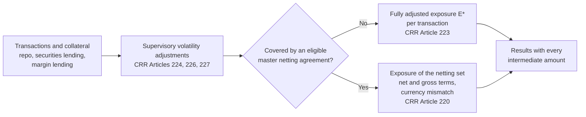

<div align="center">

# 🔁 K-SFTs

### Counterparty credit risk for securities financing transactions in Excel VBA

**Planned scope: EU CRR · Financial Collateral Comprehensive Method · Repos, securities lending and margin lending · Auditable from transaction to exposure · No real portfolio data**

<br>

[](#requirements)
[](#requirements)
[](docs/methodology/README.md#regulatory-basis)
[](#status)
[](#validation)
[](tools/README.md)
[](LICENSE)

<br>

**Plain exported VBA · Macro-free workbook template · Four default VBA references · Each implemented rule cites its CRR article**

[Website](https://danielep71.github.io/K-SFTs/)
&nbsp;·&nbsp;
[Wiki](https://github.com/danielep71/K-SFTs/wiki)
&nbsp;·&nbsp;
[Quick start](#quick-start)
&nbsp;·&nbsp;
[What exists today](#what-exists-today)
&nbsp;·&nbsp;
[How a calculation will work](#how-a-calculation-will-work)
&nbsp;·&nbsp;
[Validation](#validation)
&nbsp;·&nbsp;
[Limitations](#limitations)
&nbsp;·&nbsp;
[Roadmap](#roadmap)
&nbsp;·&nbsp;
[Methodology](docs/methodology/README.md)

---

<p align="center">
  
</p>

---

</div>

> [!IMPORTANT]
> **Status: working prototype, not a validated method.** The repository holds
> a prototype that calculates E\*, RWA and own funds of SFT netting sets
> ([PROTOTYPE.md](docs/methodology/PROTOTYPE.md)). It runs in Excel and
> reproduces an independent reference, but it is not the methodology of
> record and departs from recorded decisions. Nothing here should be used to
> compute regulatory exposure. The regulatory basis is chosen: the EU CRR
> controls, with the Basel Framework as the methodological reference;
> products, collateral and outputs are still open decisions.

> [!NOTE]
> A workbook is **never stored in the repository as a macro-enabled file**.
> It is built from the macro-free template `src/workbook/SFT_Template.xlsx`
> and the exported VBA source, so every line of code is reviewable in a pull
> request.

## ✨ What this project is

**Securities financing transactions** (SFTs) are repurchase and reverse
repurchase agreements, securities lending and borrowing, and margin lending:
a cash or securities exposure on one side, collateral on the other. Their
counterparty credit risk is measured with the credit risk mitigation
framework, not with SA-CCR.

**K-SFTs** is intended to become an independent Excel/VBA implementation of
that measurement under the EU CRR: you enter transactions, collateral and
netting sets; the engine applies the supervisory volatility adjustments and
computes the exposure value, with every intermediate amount visible and
every rule traced to its CRR article and paragraph.

It is built for people who need to **check** an SFT exposure figure rather
than only produce one. Derivatives exposure, under SA-CCR, is out of scope
here.

<a id="where-k-sfts-belongs"></a>

### Where K-SFTs belongs

K-SFTs is one calculator of a counterparty credit risk framework: it
produces the exposure value E\* of securities financing transactions, the
**K-SFT** box of step 1. The derivatives exposure belongs to
[K-SACCR](https://github.com/danielep71/VBA-SACCR-Toolkit); the capital
steps, ordinary and CCP, and the CVA memo item belong to the wider framework
of [K-Risk Engines](https://github.com/danielep71/K-Risk-Engines).

[](docs/assets/CCR_framework.svg)

[Editable SVG](docs/assets/CCR_framework.svg) ·
[High-resolution PNG](docs/assets/CCR_framework.png)

This is an architecture diagram, not evidence of an implemented or validated
calculation. Today the [prototype](docs/methodology/PROTOTYPE.md) covers the
K-SFT box and the standardised risk weight, RWA and own funds of each
netting set, a QCCP taking the 2% trade-exposure weight. Default-fund
capital and CVA are not implemented here.

---

<a id="what-exists-today"></a>

## 🎯 What exists today

The first milestone, *v0.1.0 - Repo setup*, built the foundation the
calculation stands on; *v0.2.0 - Prototype setup* adds the prototype as it is:

| Area | Delivered |
| --- | --- |
| Regulatory basis | EU CRR (Regulation (EU) No 575/2013 with Regulation (EU) 2024/1623) as the controlling text, the Basel Framework as reference, EBA Q&As for interpretation; registered copies with their hashes ([methodology](docs/methodology/README.md)) |
| First scope | Financial Collateral Comprehensive Method (CRR Article 223) with supervisory volatility adjustments; bilateral SFTs, single or under an eligible master netting agreement ([first scope](docs/methodology/README.md#scope)) |
| Test-case contract | The format, reference classes and tolerances of future numerical test cases, enforced by a gate ([TEST_CASES.md](docs/methodology/TEST_CASES.md)) |
| VBA conventions | House style, naming, error and cleanup contracts, ASCII source with CRLF checkout, public-API inventory ([VBA_HOUSE_STYLE.md](docs/VBA_HOUSE_STYLE.md)) |
| Regression harness | `TEST_Harness` with a neutral example suite: assertions, tolerances, error values, completeness and an Excel-state cleanup verdict ([running the harness](INSTALLATION.md#running-the-harness)) |
| Excel evidence | A procedure and a checker that bind an Excel run to its exact commit, record by record ([recording an Excel run](INSTALLATION.md#recording-an-excel-run)) |
| Workbook build | A macro-free template and an optional script that imports the repository's VBA into a workbook built from it ([synchronizing VBA](INSTALLATION.md#synchronizing-vba)) |
| Repository checks | `python tools/check.py` with 17 gates, run by CI on every pull request and on pushes to `main` and `release/**` ([tools/README.md](tools/README.md)) |
| Governance | Branch model, integration and sync, rulesets on `main`, `release/**` and `v*` tags, review records, issue rules and a 20-label catalogue ([GOVERNANCE.md](docs/GOVERNANCE.md)) |
| Prototype | E\* under the FCCM with supervisory haircuts (CRR Articles 220, 223, 224, 226, 227), risk weight, RWA and own funds per netting set; eight `SFT_*` worksheet functions; an 11-sheet template with a demo portfolio, a test catalogue and formula tests; an independent Python reference and a LibreOffice regression ([PROTOTYPE.md](docs/methodology/PROTOTYPE.md)) |
| Releases | SemVer, a changelog with its own gate, and a release procedure that separates preparation from publication ([RELEASING.md](RELEASING.md)) |

Not available yet: an exposure calculation, a public API, a production
workbook or a release. No figure produced from this repository should be
relied on.

---

<a id="quick-start"></a>

# ⚡ Quick start

## 1. Clone and check

```sh
git clone https://github.com/danielep71/K-SFTs.git
cd K-SFTs
git switch release/0.2.0
python tools/check.py
```

Use a clone, not **Download ZIP** or GitHub's **Raw** view: a clone checks the
VBA out with the CRLF line endings the VBE expects. The prerequisites and the
pinned tool versions are in the
[developer setup](INSTALLATION.md#developer-setup).

## 2. Build a development workbook

1. Open `src/workbook/SFT_Template.xlsx` and save it as an **Excel
   Macro-Enabled Workbook (`.xlsm`)** outside the checkout or in the ignored
   `test-results/` directory.
2. Import the test modules of `tests/modules/` by hand
   ([importing VBA into Excel](INSTALLATION.md#importing-vba-into-excel)),
   or drag the closed workbook onto `tools/Sync-KSFT-VBA.cmd` and answer
   **D** for development. The script is optional and needs *Trust access to
   the VBA project object model*.
3. Open the VBE (**Alt+F11**) and run **Debug → Compile VBAProject**.

## 3. Run the harness

In the Immediate window (**Ctrl+G**):

```text
TEST_Examples.RunExampleTests
```

A passing run ends with:

```text
RESULT=PASS; suite=examples; operation=PASS; completeness=COMPLETE; cases=9; assertions=18; failures=0; cleanup=PASS; recovery=NONE
```

The suite exercises the harness itself and contains no SFT calculation.

---

<a id="how-a-calculation-will-work"></a>

# 🔄 How a calculation will work

This is the **planned** flow of the first scope. No step is implemented, and
no formula or haircut is transcribed until it is checked against the CRR
text ([traceability](docs/methodology/README.md#traceability)).



| Step | Source | Status |
| --- | --- | --- |
| Transaction and collateral records | Products (D4) and collateral (D6) | Open decisions |
| Supervisory volatility adjustments | CRR Articles 224, 226, 227; Basel CRE22 | Registered, not transcribed |
| Single transaction: fully adjusted exposure value E* | CRR Article 223 | Registered, not transcribed |
| Master netting agreement: exposure of the netting set | CRR Articles 206 and 220(2)–(3); Basel CRE22.64–22.65 | Registered, not transcribed |
| Output measures | D7 | Open decision |

---

<a id="validation"></a>

# ✅ Validation

| Evidence | Result | Record |
| --- | --- | --- |
| Static gates | 17 gates, required to PASS on every pull request and run on pushes to `main` and `release/**`: tooling tests, labels, issue forms, test cases, changelog, VBA source rules, workflows, Ruff and strict mypy | [tools/README.md](tools/README.md) |
| Excel host run | Harness and example suite at `1a6f0f7` imported, compiled and run in Excel 16.0 (build 20430, 64-bit, VBA7) on Windows 11 Enterprise 25H2: the normal run passed, both failure paths ended as documented, `check_excel_run.py` PASS | [tested environments](INSTALLATION.md#tested-environments), #9 |
| Workbook synchronization | The sync script imported the test modules into a workbook built from the template, and the suite passed in it | #102 |
| SFT calculation | Nothing to validate yet | — |

Static checks never stand in for Excel evidence: since the first host run,
changed VBA merges only after an Excel run
([VBA_HOUSE_STYLE.md](docs/VBA_HOUSE_STYLE.md)).

---

## 📦 Repository structure

```text
src/     production VBA source and the macro-free workbook template
tests/   VBA test modules, fixtures and expected results
docs/    methodology and regulatory sources, governance, house style, artwork
tools/   repository checks, Excel-run checker, VBA synchronizer, traffic history
```

The full layout, the dependency direction and the public API boundary are in
[`docs/REPOSITORY_STRUCTURE.md`](docs/REPOSITORY_STRUCTURE.md).

---

<a id="requirements"></a>

# 💻 Requirements

| For | Needs |
| --- | --- |
| The VBA | Desktop Excel for Windows, 64-bit: Microsoft 365 or Excel 2016 and later; 32-bit is best effort ([supported hosts](INSTALLATION.md#supported-hosts)) |
| The checks | Git and Python 3.12 or later; Node.js, Ruff, mypy and actionlint for the full set ([developer setup](INSTALLATION.md#developer-setup)) |

---

<a id="limitations"></a>

## ⚠️ Known limitations

- **Prototype only.** The calculation is a prototype, not the methodology of
  record: it departs from recorded decisions (a BCBS regime, a QCCP class,
  the open decisions D4, D6 and D7), its expected values are illustrative,
  and there is no numerical test case in the format of
  [TEST_CASES.md](docs/methodology/TEST_CASES.md) and no production
  workbook ([departures](docs/methodology/PROTOTYPE.md)).
- **Excel evidence on one host.** Recorded manually on one 64-bit host;
  32-bit Office and other builds are untested.
- **Regulatory texts registered, not yet checked against the prototype.**
  The prototype's formulas and tables are not yet checked against the
  registered copies, page by page.
- **Security scanning not enabled.** Secret scanning, push protection,
  code scanning and Dependabot security updates are off; vulnerabilities
  are reported privately on GitHub or by email ([SECURITY.md](SECURITY.md)).
- **CI artifacts expire after 30 days.**
- **Windows desktop Excel only.**

---

<a id="roadmap"></a>

## 🗺️ Roadmap

| Step | Scope |
| --- | --- |
| v0.1.0 - Repo setup | Tooling, governance, conventions, the harness and its Excel evidence; closed by a certification from a fresh checkout, without a release (#13) |
| v0.2.0 - Prototype setup | The prototype as it is, working in Excel and included into `main`, with no further development (#131 to #134) |
| Open decisions | Products in scope (D4), collateral (D6), output measures (D7) ([open decisions](docs/REPOSITORY_STRUCTURE.md#-open-product-and-methodology-decisions)) |
| Later milestones, up to v1.0.0 | The prototype's departures resolved, the first-scope calculation, its numerical certification, and the production workbook |

Separate scope decisions, each needing its own issue: the internal models
approach, CCP-cleared SFTs, the CRE56 haircut floors, the Financial
Collateral Simple Method, and other prudential measures
([first scope](docs/methodology/README.md#scope)).

---

## 📚 Documentation

| Document | Covers |
| --- | --- |
| [`docs/methodology/`](docs/methodology/README.md) | Regulatory basis, first scope, version applicability, source register, traceability |
| [`docs/methodology/sources/`](docs/methodology/sources/README.md) | Copies of the regulatory texts relied on, with hashes and terms of use |
| [`docs/methodology/TEST_CASES.md`](docs/methodology/TEST_CASES.md) | Test-case files, tolerances, reference classes, completeness |
| [`docs/REPOSITORY_STRUCTURE.md`](docs/REPOSITORY_STRUCTURE.md) | Scope, profile, layout, dependency direction, public API boundary, open decisions |
| [`docs/VBA_HOUSE_STYLE.md`](docs/VBA_HOUSE_STYLE.md) | VBA naming, contracts, errors, cleanup, encoding |
| [`INSTALLATION.md`](INSTALLATION.md) | Supported hosts, developer setup, building a workbook, the harness, recording an Excel run |
| [`tests/README.md`](tests/README.md) | The harness and its log format |
| [`tools/README.md`](tools/README.md) | Repository checks, the Excel-run checker and VBA synchronization |
| [`CONTRIBUTING.md`](CONTRIBUTING.md) | Reporting a problem with synthetic data; the development workflow; validation rules |
| [`docs/GOVERNANCE.md`](docs/GOVERNANCE.md) | Branches, integration, review, protection, issues, releases |
| [`docs/TRAFFIC.md`](docs/TRAFFIC.md) | Repository traffic history |
| [`CHANGELOG.md`](CHANGELOG.md), [`RELEASING.md`](RELEASING.md) | Changes by version; preparing and publishing a release |
| [`SECURITY.md`](SECURITY.md) | Reporting vulnerabilities; synthetic data only |
| [`NOTICE.md`](NOTICE.md), [`LICENSE`](LICENSE) | Copyright, provenance and the MPL-2.0 licence |

---

<a id="status"></a>

## 📌 Status

**Unreleased.** Work is in the milestone
[*v0.2.0 - Prototype setup*](https://github.com/danielep71/K-SFTs/milestone/2);
changes are recorded under `[Unreleased]` in [CHANGELOG.md](CHANGELOG.md).
Development happens on the
[active release branch](docs/GOVERNANCE.md#-branches) through task branches
and pull requests; `main` receives it through an approved integration, and
only a release is versioned and tagged.

---

## 🔐 Data and security

No real portfolio data: never commit or attach real transactions,
counterparty, collateral or netting-set data, or any client material. VBA
runs with the user's Office permissions: review the source and follow your
organisation's macro policy. Report suspected vulnerabilities privately as
described in [`SECURITY.md`](SECURITY.md).

---

## 👤 Author

**Daniele Penza** — [@danielep71](https://github.com/danielep71). This is an
independent personal project.

## 📄 License

[Mozilla Public License 2.0](LICENSE)
