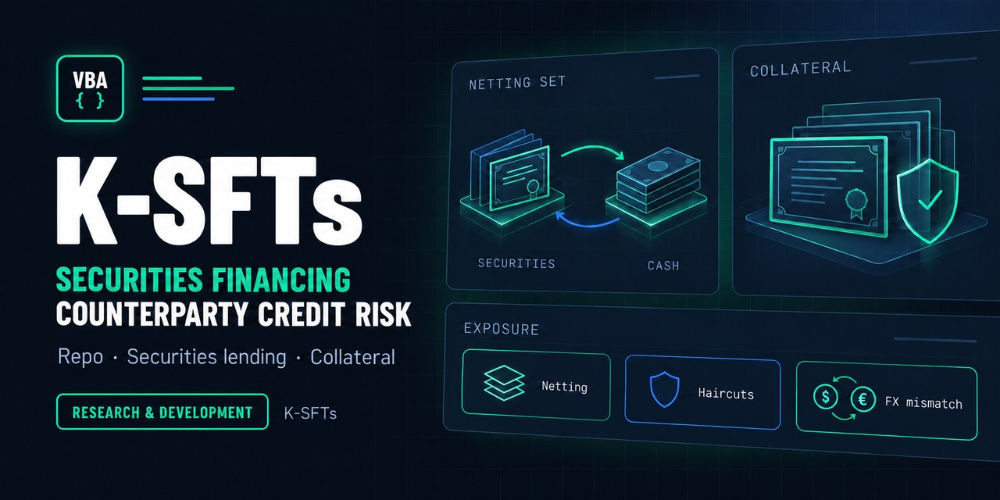

# K-SFTs

Counterparty credit risk for securities financing transactions (SFTs):
repurchase agreements, securities lending and borrowing, and margin lending.
K-SFTs is intended to become an Excel/VBA application that calculates SFT
exposure from transactions, collateral and netting sets.

> [!IMPORTANT]
> **Status: repository setup only.** There is no calculation engine, public
> API, workbook or validated method yet. Nothing here should be used to
> compute exposure. The regulatory basis is chosen: the EU CRR controls,
> with the Basel Framework as the methodological reference. The first scope
> is bilateral SFTs under the Financial Collateral Comprehensive Method;
> products, collateral and outputs are still open decisions.

This is an independent personal project.

## What exists today

- **Repository checks** (`python tools/check.py`, also run by CI on every pull
  request): tooling tests, label and issue-form configuration, the format of
  the numerical test-case files and of the changelog, static rules on the
  exported VBA source, and the workflows. They read files only: they compile no VBA and check no
  calculation.
- **A VBA regression harness** with a neutral example suite in
  `tests/modules/`. It exercises the harness itself and contains no SFT
  calculation. It has been compiled and run in 64-bit Excel on Windows 11
  ([tested environments](INSTALLATION.md#tested-environments), #9).
- **Methodology and test-case documents**: the regulatory basis, the copies
  of the texts relied on, and the format of future test cases.

Not available: an exposure calculation, a public API, a workbook or a
release. No figure produced from this repository should be relied on.

## Getting started

1. Clone the repository and switch to the active release branch
   ([get the source](INSTALLATION.md#get-the-source)).
2. Install the tools and run `python tools/check.py`
   ([developer setup](INSTALLATION.md#developer-setup)).
3. To try the harness, build a development workbook on a supported Excel host
   and run `TEST_Examples.RunExampleTests`
   ([importing VBA into Excel](INSTALLATION.md#importing-vba-into-excel),
   [running the harness](INSTALLATION.md#running-the-harness)).
4. Before proposing a change, read [CONTRIBUTING.md](CONTRIBUTING.md).

## Documents

| Document | Purpose |
| --- | --- |
| [docs/REPOSITORY_STRUCTURE.md](docs/REPOSITORY_STRUCTURE.md) | Scope, profile, layout, dependency direction, public API boundary, open decisions |
| [docs/methodology/README.md](docs/methodology/README.md) | Regulatory basis, first scope, version applicability, source register, traceability |
| [docs/methodology/sources/README.md](docs/methodology/sources/README.md) | Copies of the regulatory texts relied on, with hashes and terms of use |
| [docs/methodology/TEST_CASES.md](docs/methodology/TEST_CASES.md) | Test-case files, tolerances, reference classes, completeness |
| [docs/VBA_HOUSE_STYLE.md](docs/VBA_HOUSE_STYLE.md) | VBA naming, contracts, errors, cleanup, encoding |
| [INSTALLATION.md](INSTALLATION.md) | Supported Excel hosts; developer setup and evidence locations; importing and exporting the VBA source; running the harness |
| [CONTRIBUTING.md](CONTRIBUTING.md) | Reporting a problem with synthetic data; the development workflow; validation rules |
| [docs/GOVERNANCE.md](docs/GOVERNANCE.md) | Branches, integration, review, protection, issues, releases |
| [docs/TRAFFIC.md](docs/TRAFFIC.md) | Repository traffic history |
| [tools/README.md](tools/README.md) | Repository checks: `python tools/check.py` |
| [SECURITY.md](SECURITY.md) | Reporting vulnerabilities; synthetic data only |
| [CHANGELOG.md](CHANGELOG.md), [RELEASING.md](RELEASING.md) | Changes by version; preparing and publishing a release |
| [NOTICE.md](NOTICE.md), [LICENSE](LICENSE) | Copyright, provenance and the MPL-2.0 licence |

No version has been released yet: changes are recorded under
`[Unreleased]` in [CHANGELOG.md](CHANGELOG.md).
